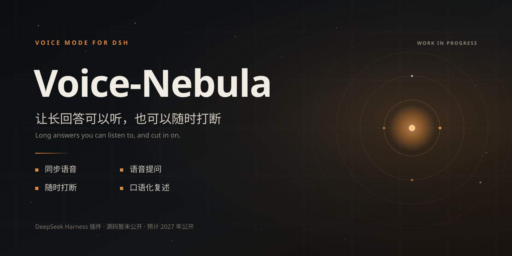
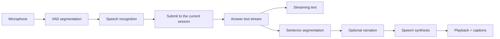

# Voice-Nebula

[中文](README.md) · [English](README.en.md)

Voice-Nebula is a voice interaction plugin for DeepSeek Harness (DSH). Answers keep streaming as text while speech follows sentence by sentence. When a new question appears, you can speak up and stop the current playback. This is a third-party project, not an official DeepSeek product.

> **Status:** in active development. The source is not public yet, there is no npm package, and the plugin cannot be installed at the moment. The first public release is planned around 1 January 2027. This is a plan, not a commitment.

## Does this sound familiar?

- The AI explains a hard question properly, and the answer runs three screens long. Halfway through, a new question shows up, but you still have to finish reading.
- You want to ask right away, but your hands keep moving between the keyboard, the scrollbar and the input box. By the time the sentence is ready, the thought has gone.
- You do want the full, detailed explanation. You just don't want to be dragged along by a long text you haven't finished.
- Your phone is in your pocket, or your hands are busy. When the screen is out of view, text is hard to take in.

Voice-Nebula changes that last part. Text is still being generated when speech starts. You can cut in at any point; playback stops and the conversation moves to the new question. Long answers can stay long and detailed. What changes is how you receive them, and how much control you have in the conversation.

## What it is

One DSH plugin, covering Web / Desktop and TUI.

- **Web / Desktop**: the host provides HTTP + SSE. A voice panel and a caption layer are injected into the page. Text renders as usual; speech has its own playback queue.
- **TUI**: a full-screen voice scene, commands, shortcuts and a status line. Speech goes through Edge TTS first, with a Windows SAPI fallback offline.
- **Two channels**: narration never rewrites the body text. The answer model and the narration model are selected separately.

## Design principles

1. **Sentence-level streaming.** Text comes first; speech follows per sentence. The plugin does not wait for the full answer.
2. **Interrupt at any time.** Speaking or pressing a button stops playback. Cancelling the current answer as well is configurable.
3. **Depth is not traded for listenability.** The body stays complete. A shorter spoken version comes from a separate narration model, not from editing the original.
4. **Each host gets its own shape.** Web / Desktop uses a panel, captions and SSE; TUI uses a full-screen scene, shortcuts and a status line. They are not forced into the same interface.
5. **Status follows evidence.** Harness-passed, device-pending and planned are labeled separately.

## Where it stands

| Capability | Status | Notes |
| --- | --- | --- |
| Speech while generating | Implemented | Text streams; speech is synthesized per sentence. First audio packet is roughly 250–400 ms on a warm local connection; network dependent |
| Voice input | Pipeline implemented; device test pending | Mic → VAD → host speech recognition → current session. Audio upload is available when no mic is present |
| Barge-in | Implemented; device test pending | A button or detected speech stops playback; optionally cancels the current answer |
| Captions | Implemented | Off / 1–3 lines, word by word; driven by the same stream as speech |
| Separate models | Implemented | Answer and narration models are independent; both expose reasoning effort |
| Dialects and tone | Implemented within engine limits | Edge TTS covers Mandarin, Northeastern, Shaanxi, Cantonese and Taiwan Mandarin. Tone is simulated with rate and pitch |
| TUI | Implemented; keyboard test pending | Full-screen scene, 3 commands, 8 shortcuts, 10 themes; Windows SAPI fallback offline |
| Prerequisite status | Implemented | Six checks: recognition, local model, TTS, model service, session bridge, web connection |
| Technical site and demo video | Built internally | Ships with the source; not included in this public repository |

> "Implemented" means the local test harness passes. "Device test pending" means the test machine has no microphone or interactive terminal, so the end-to-end path has not been completed on real hardware. Edge TTS's free endpoint does not accept SSML emotion tags; "tone" is a rate and pitch preset, not native emotional synthesis.

## Not finished, not verified

- **Real microphone**: the test machine has no usable microphone. Voice input has been tested against an isolated host and through the upload path, but not with a real spoken sentence.
- **TUI keyboard**: this session has no interactive terminal. The scene and shortcuts still need to be pressed in a real window.
- **Voice-triggered barge-in**: the client logic and host event have been tested; triggering it with a real microphone is pending.
- **Streaming recognition**: recognition currently runs after you stop speaking, not while you speak.
- **DSH-GO**: mobile integration is under exploration, with no schedule commitment and no claim of official integration.
- **Cross-platform architecture**: TypeScript is a candidate; the current code is JavaScript and has not been migrated.

## What comes next

| When | What | Status |
| --- | --- | --- |
| Q4 2026 | Finish real-device microphone, TUI keyboard and barge-in checks | In progress |
| Q4 2026–2027 | Evaluate DSH-GO integration and a cross-platform structure | Exploring |
| Around 1 January 2027 | First public source release and npm package | Planned |
| Before release | Review publication scope and third-party dependencies | In progress |

The date is a current plan, not a fixed promise. The publication scope and package name may still change before the first public release.

## How it works

Text and speech are separate channels. If synthesis fails or times out, text keeps going. If no narration model is configured, the original text is spoken. Web / Desktop delivers events over HTTP + SSE; TUI connects the same controller events to commands, a full-screen scene and a local player.

## Stack

| Layer | Current choice |
| --- | --- |
| Runtime | Node.js 24 |
| Plugin framework | Cordis |
| Host | DeepSeek Harness (Web / Desktop / TUI) |
| Speech synthesis | Edge TTS (WebSocket); Windows SAPI fallback offline |
| Speech recognition | SenseVoice, provided by the host; currently non-streaming |
| Transport | HTTP + SSE |
| Client | React (provided by the host) + Web Audio |
| TUI | Commands, full-screen scene, status line; PowerShell + WPF |
| Video assets | Browser MediaRecorder + ffmpeg (internal, not shipped in the package) |

The current implementation is JavaScript with no build step. TypeScript is only an option under evaluation for cross-platform work; it has not been adopted.

## Why Edge TTS first

Zero keys, zero cost, and a usable set of Chinese voices, including Northeastern, Shaanxi, Cantonese and Taiwan Mandarin. The trade-off is that it uses Edge's free Read Aloud endpoint: it does not accept SSML emotion tags, so emotion is simulated with rate and pitch. Audio is synthesized per sentence, not as a native PCM stream.

Azure or DashScope are the intended options when you need a more stable service, more dialects or real emotion. Their configuration fields are reserved, but the adapters are not wired up yet. The current offline fallback is Windows SAPI.

## Why this repository has no source yet

The source is still being iterated on internally. This repository currently holds the project direction, feature status, license and promotional assets. The documentation and artwork are released under the MIT License. The source, npm package and installation instructions will arrive together at the first public release under the same license. MIT does not grant rights to the project name, logo or third-party trademarks.

## Feedback

Use GitHub Issues to report problems. Please do not post API keys, access tokens, private conversations, recordings or other personal data.

## License and third parties

The project uses the MIT License; see [LICENSE](https://github.com/JumpTea/Voice-Nebula/blob/main/LICENSE) for the full text. The README, artwork and license text in this repository are released under MIT. The plugin source is not public yet and will be released under the same license. MIT does not grant rights to the project name, logo or third-party trademarks.

Third-party components used or called by the project remain the property of their authors and are governed by their own licenses and terms, including DeepSeek Harness, Cordis, Edge TTS, SenseVoice and React. Third-party code and assets are not claimed as original work of this project.

If this direction is useful to you, a Star will help more people find it at release.
