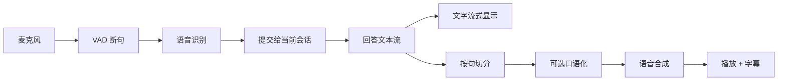

# Voice-Nebula

[中文](README.md) · [English](README.en.md)

Voice-Nebula 是给 DeepSeek Harness（DSH）做的语音交互插件。回答继续以文字流式出现，语音按句跟上；你想到新问题时，可以直接开口，把当前朗读停下来。这是一个第三方项目，不是 DeepSeek 官方产品。

> **当前状态**：内部开发中。源码暂未公开，npm 包尚未发布，暂时无法安装。预计 2027 年 1 月 1 日前后发布首个公开版本。这是当前计划，不是承诺。

## 你是否也遇到过这些情况？

- AI 把一个复杂问题讲透，回答写到第三屏。你读到一半，新的问题已经冒出来，却还得先把剩下的读完。
- 想立刻追问，手在键盘、滚动条和输入框之间来回切。等组织好语言，刚才那点灵感已经散了。
- 你确实需要完整、深入的解释，但不想被一篇没读完的长文牵着走。
- 手机在口袋里，或者手上正忙。屏幕不在眼前，信息就很难进来。

Voice-Nebula 想改的是这一段：文字还在生成，语音已经开始；你随时可以插话，朗读停下，话题转到新的方向。长回答仍然可以完整、深入，改变的是你获取它的方式，以及你在对话里的主动权。

## 它是什么

一个 DSH 插件，同一个包覆盖 Web / Desktop 和 TUI。

- **Web / Desktop**：宿主提供 HTTP + SSE，页面里注入语音面板和字幕层。文字照常流式渲染，语音走单独的播放队列。
- **TUI**：全屏语音场景、命令、快捷键和状态行；声音优先走 Edge TTS，离线时回退 Windows SAPI。
- **两条通道**：正文不被朗读改写；语音只负责把内容说成人话。回答模型和口语化模型可以分开选。

## 设计原则

1. **句级流式，不等人说完。** 文字先出，语音按句跟上；不把整段回答合成完再播。
2. **随时可以打断。** 说话或点按钮都能停朗读；是否连当前回答一起取消，可以配置。
3. **不为了好读牺牲深度。** 正文保持完整；需要更短的口语版时，另开一路复述模型，不改原文。
4. **每个宿主有自己的形态。** Web / Desktop 用面板、字幕和 SSE；TUI 用全屏场景、快捷键和状态行。不强行做成同一个界面。
5. **状态按验证结果标注。** 验收台通过、真机待确认、计划中，三种状态分开写。

## 已经做到哪一步

| 能力 | 状态 | 说明 |
| --- | --- | --- |
| 边生成边朗读 | 已实现 | 正文流式显示；按句切分后合成。本机热连接下首包约 250–400 ms，随网络变化 |
| 语音提问 | 链路已实现，真机待确认 | 麦克风 → VAD 断句 → 宿主语音识别 → 当前会话；没有麦克风时可上传音频 |
| 打断 | 已实现，真机待确认 | 按钮或检测到开口时停止朗读；可选是否取消当前回答 |
| 字幕 | 已实现 | 关闭 / 1–3 行，逐词显示；和口语流同源 |
| 模型分开选 | 已实现 | 回答模型与口语化模型独立；两边都能选思考强度 |
| 方言与语气 | 已实现（引擎范围内） | Edge TTS 覆盖普通话、东北话、陕西话、粤语、台湾国语；语气用语速和音高预设模拟 |
| TUI 形态 | 已实现，键盘待确认 | 全屏场景、3 个命令、8 个快捷键、10 套主题；离线回退 Windows SAPI |
| 前置状态 | 已实现 | 识别服务、本地模型、合成引擎、模型服务、会话桥、网页连接六项 |
| 技术站与解说视频 | 内部完成 | 随源码发布；当前公开仓库不包含 |

> 「已实现」只表示本机验收台通过；「真机待确认」表示测试机缺少麦克风或可交互终端，端到端还没在真实设备上走完。Edge TTS 的免费端点不接受 SSML 情绪标签，所以「语气」是语速和音高预设，不是原生情绪合成。

## 还没做完，也还没验证

- **真机麦克风**：测试机没有可用麦克风。语音输入只在隔离宿主和上传通路上验过，真实说一句还没走完。
- **TUI 键盘**：当前会话没有可交互终端。场景和快捷键需要你在真实窗口里按一遍。
- **开口打断**：客户端逻辑和宿主事件已经验过；真实麦克风触发待确认。
- **流式识别**：现在识别是「说完再转写」，不是边说边出字。
- **DSH-GO**：手机端集成还在探索，没有排期承诺，也不代表官方集成。
- **跨端架构**：TypeScript 是候选方向，当前代码是 JavaScript，尚未迁移。

## 接下来

| 时间 | 计划 | 状态 |
| --- | --- | --- |
| 2026 Q4 | 补齐真机麦克风、TUI 键盘和开口打断的验证 | 进行中 |
| 2026 Q4–2027 | 评估 DSH-GO 集成与跨端结构 | 探索 |
| 2027-01-01 前后 | 首个公开源码版本与 npm 包 | 计划 |
| 发布前 | 复核公开范围与第三方依赖 | 进行中 |

2027 年 1 月 1 日是当前计划，不是不可变更的承诺。公开范围和包名仍可能在正式发布前调整。

## 它怎么工作

正文和语音是两条独立通道。语音合成失败或超时，正文仍然继续；口语化模型没有配置时，直接朗读原文。Web / Desktop 用 HTTP + SSE 把事件送到页面；TUI 用命令、全屏场景和本地播放器接同一套控制器事件。

## 技术栈

| 层 | 现在用什么 |
| --- | --- |
| 运行时 | Node.js 24 |
| 插件框架 | Cordis |
| 宿主 | DeepSeek Harness（Web / Desktop / TUI） |
| 语音合成 | Edge TTS（WebSocket）；Windows SAPI 离线回退 |
| 语音识别 | 宿主提供的 SenseVoice；当前为非流式 |
| 传输 | HTTP + SSE |
| 客户端 | React（宿主提供）+ Web Audio |
| TUI | 命令、全屏场景、状态行；PowerShell + WPF |
| 视频素材 | 浏览器 MediaRecorder + ffmpeg（内部制作，不随包发布） |

当前实现是 JavaScript，没有构建步骤。TypeScript 只是跨端评估方向，还没有落地。

## 为什么先用 Edge TTS

零密钥、零成本，中文音色够用，还带东北话、陕西话、粤语和台湾国语。代价是它走 Edge「大声朗读」的免费端点：不接受 SSML 情绪标签，只能用速率和音高模拟；音频按句合成，不是原生 PCM 流。

需要更稳定的服务、更多方言或真情绪时，可以接 Azure / DashScope。配置里预留了这两个引擎的字段，但适配器还没接入；当前的离线兜底是 Windows SAPI。

## 现在为什么只有文档和素材

源码还在内部迭代。这个仓库先放项目方向、功能状态、许可证和宣传素材。文档与素材按 MIT 许可证发布；源码、npm 包和安装方式会在正式发布时一起给出，并采用同一许可证。MIT 不授予项目名称、Logo 或第三方商标的使用权。

## 反馈

用 GitHub Issues 反馈。请勿贴 API Key、访问令牌、个人对话、录音或其他隐私数据。

## 许可证与第三方

项目采用 MIT 许可证，完整文本见 [LICENSE](https://github.com/JumpTea/Voice-Nebula/blob/main/LICENSE)。当前仓库中的 README、宣传素材和许可证文本按 MIT 发布；插件源码尚未公开，正式发布时将以同一许可证提供。MIT 不授予项目名称、Logo 或第三方商标的使用权。

项目依赖或调用的第三方组件归各自作者所有，遵循各自的许可与服务条款，包括 DeepSeek Harness、Cordis、Edge TTS、SenseVoice、React 等。第三方代码和素材不被声明为本项目原创。

如果这个方向对你有用，Star 能让它在发布时被更多人看到。
